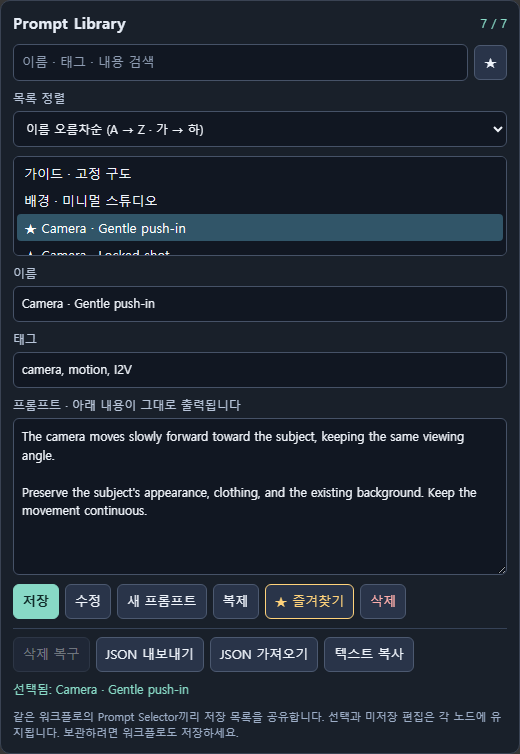
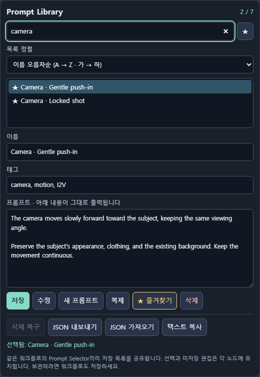
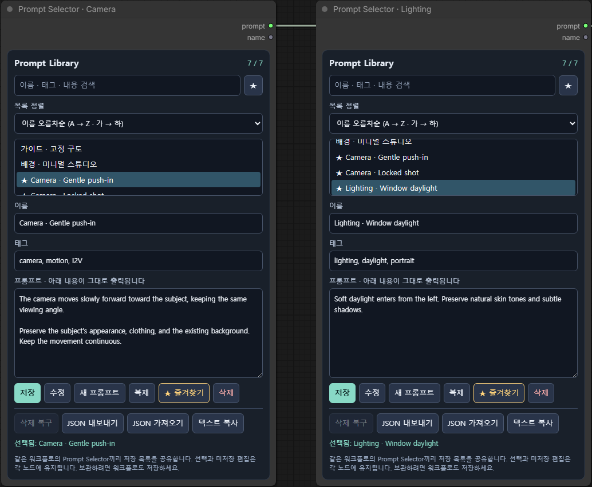

# 프롬프트를 저장하고 골라 쓰는 ComfyUI Prompt Selector

ComfyUI에서 작업하다 보면 좋은 결과를 낸 프롬프트를 메모장에 옮겨 두거나, 예전 워크플로를 열어 다시 복사하게 됩니다. Prompt Selector는 이 반복 작업을 줄이기 위해 만든 작은 프롬프트 라이브러리 노드입니다.

이름과 태그를 붙여 프롬프트를 저장하고, 목록에서 골라 다음 노드에 연결할 수 있습니다. 별도 모델이나 API 계정은 필요하지 않습니다. 이미지에 보이는 내용은 공개용 예제입니다.

## 저장과 수정의 역할을 나눴습니다

현재 적힌 내용을 새 버전으로 남기고 싶으면 **저장**을 누르면 됩니다. 매번 ‘새 프롬프트’를 누르고 다시 입력할 필요가 없습니다. 선택한 기존 항목 자체를 고치고 싶을 때는 **수정**을 사용합니다.

예를 들어 느린 카메라 전진 프롬프트를 선택한 뒤 움직임을 조금 바꾸고 저장하면 원본과 새 버전이 모두 남습니다. 오탈자만 고칠 때는 수정하면 됩니다. 이름이 같아도 번호가 붙어 구분됩니다.

## 목록이 길어져도 찾아 쓰기 쉽게

검색은 이름뿐 아니라 태그와 프롬프트 본문에서도 찾습니다. 자주 쓰는 항목에는 즐겨찾기를 붙이고, 목록은 등록순이나 이름 오름차순·내림차순으로 정렬할 수 있습니다. 한글과 영문 이름을 함께 사용할 수 있습니다.

카메라, 조명, 제품 사진, 인물 사진처럼 용도별 태그를 달아 두면 반복 작업에서 필요한 문구를 찾기 편합니다.

## 같은 워크플로에서는 목록을 함께 사용

하나의 워크플로에 Prompt Selector를 여러 개 넣으면 저장 목록을 공유합니다. 한 노드에서 프롬프트를 추가하거나 수정하면 다른 노드의 목록에도 반영됩니다. 각 노드는 자기 선택과 미저장 편집을 유지하므로 카메라 프롬프트와 조명 프롬프트를 서로 다르게 선택할 수 있습니다.

다른 워크플로로 옮기거나 다른 사람에게 컬렉션을 전달할 때는 JSON 내보내기·가져오기를 사용합니다. 워크플로 사이에 자동으로 동기화되는 전역 라이브러리는 아닙니다.

## 처음 사용한다면

1. `custom_nodes` 아래에 설치하고 ComfyUI를 재시작합니다.
2. Prompt Selector를 추가하고 이름과 내용을 입력해 저장합니다.
3. `prompt` 출력을 텍스트 입력에 연결합니다.
4. 다음에도 쓸 수 있도록 워크플로를 저장합니다.

함께 제공되는 [기본 예제](../examples/basic-prompt-selector.json)는 모델 없이 문자열 출력을 확인할 수 있습니다. [예제 컬렉션](../presets/starter-prompts.json)을 가져와 직접 검색과 정렬을 시험해 봐도 좋습니다.

이 노드는 현재 편집 중인 텍스트를 그대로 출력합니다. 따라서 저장하지 않은 수정도 실행에 사용됩니다. 공유할 워크플로에는 전체 라이브러리와 초안이 포함될 수 있으므로, 공개용 컬렉션을 담은 별도 워크플로로 공유하는 것이 좋습니다.

설치와 세부 사용법은 [한국어 README](../README.ko.md)에 정리했습니다.

---

GitHub About 제안: Reusable prompt library for ComfyUI with save/update, search, sorting, favorites, JSON transfer, and shared lists within a workflow.

토픽 제안: `comfyui`, `comfyui-custom-node`, `prompt-library`, `prompt-management`
